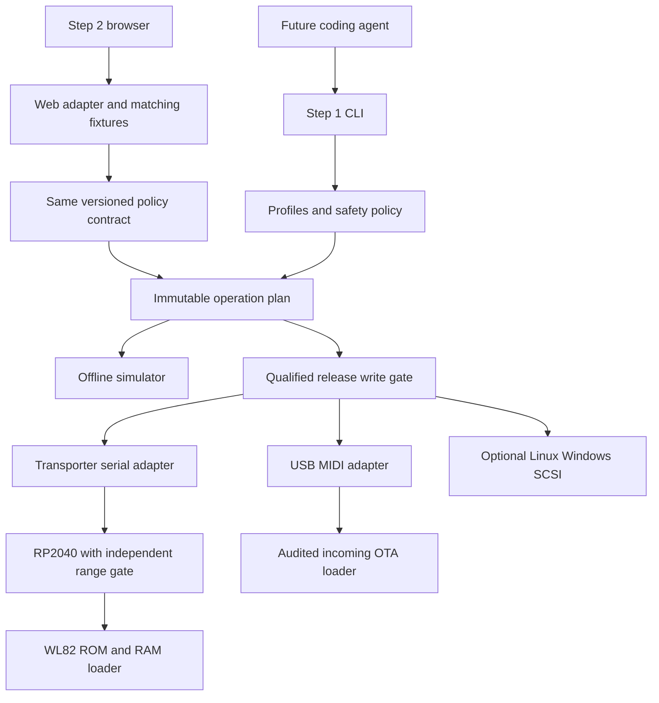

> Historical documentation archive, 2026-10-16. This is not the active
> implementation, current acceptance status, or permission to run commands.
> Local paths and digests are conservatively omitted; exact originals remain
> in the private recovery archive. See [archive policy](../README.md).

# CLI-first FM-1 flasher plan

Date: 2026-10-11. Status: proposed architecture; **offline implementation can start, owner-device writes cannot**. Read the [research](01-github-research.md) and [safety policy](03-single-device-safety.md) first.

## 1. Recommended starting point: fork FM-1 Transporter

The authorized fork is [kmplngj/FM-1-transporter](https://github.com/kmplngj/FM-1-transporter), based on [upstream](https://github.com/kurogedelic/FM-1-transporter/tree/a632d923203170e3a08565f4056dbb3fd3d65ca5). Keep the upstream layout/history, MIT attribution, firmware source, PIO implementation and Pico-PIO-USB dependency pins. Add a host package, fixtures, tests and these specifications. Forking the recovery project does **not** make an RP2040 a requirement for normal installation.

Why this foundation:

- Its USB_KEY mechanism reaches the immutable WL82/AC791N ROM even when the installed application exposes no USB device. The host sees a serial bridge rather than needing platform-specific SCSI access.
- The bridge's existing firmware limits writes to `[0x4000, 0x93000)`. Independent enforcement on the board is valuable if the host parser makes a mistake.
- It already supports full flash reads, sector-level readback and differential application writes. Its README and device logs report operation from a Mac.
- Its existing `tools/fm1t.py` is a prototype host client: macOS-specific port discovery and a package-review dependency on `fm-1-research-lab`, whose public URL was unavailable during this research. Replace that dependency with a self-contained audited parser rather than assuming the existing host tool is a complete product. [Protocol](https://github.com/kurogedelic/FM-1-transporter/blob/a632d923203170e3a08565f4056dbb3fd3d65ca5/docs/PROTOCOL.md), [host source](https://github.com/kurogedelic/FM-1-transporter/blob/a632d923203170e3a08565f4056dbb3fd3d65ca5/tools/fm1t.py).

Keep the RP2040 firmware unchanged initially. Improving a recovery dongle creates its own risk: a regression in USB_KEY, loader upload or write limits can remove the escape route. Maintain a known-good, hash-pinned upstream dongle image separately from any future experimental build. Do not test new dongle write firmware against the owner's FM-1.

Reuse the MIT [MvaveFM1Unbricker](https://github.com/Quixotic7/MvaveFM1Unbricker/tree/b8c8e8afbcba3e45b262b3b624ab9d0244b92628) parser, mock-device and Transporter-client ideas after auditing them. Its host-side range check must be tightened to the intended operation, not merely the entire flash capacity. Felucca's CLI/web/loader code is GPL-3.0-only; copying it requires a deliberate licensing decision. AL-255's repository is WTFPL v2, but review file-specific attribution. The JieLi RAM loader is a separately sourced binary: verify its origin/hash and redistribution terms before shipping it. Do not silently bundle it or vendor firmware.

## 2. Scope and meaning of direct installation

**Step 1 is the CLI. Step 2 is the web tool.** The subsections below are work within step 1, not a requirement to implement the browser before recovery.

**Owner priority (2026-10-11): connect one USB-C data cable and flash, without buying an RP2040 for routine installation.** USB-MIDI is the primary normal-install route; the bridge is an emergency fallback. The protocol is already evidenced, but this host's exact edges, loaders, preboot verification and recovery behavior remain unqualified. Keep development offline and real writes disabled while that evidence is missing. [Device-pull USB-MIDI protocol](https://github.com/AL-255/FM-1-RE/blob/ec832f281ca165a7d5e0722985f3acb1465046d5/docs/io/11-ota-protocol.md).

| Device state | USB-C only goal | Limit / fallback |
|---|---|---|
| Working application or reachable MIDI OTA loader | Qualified direct USB-MIDI installation, no dongle | Exact source/target/data and loader behavior must qualify; ordinary OTA lacks a demonstrated full preboot raw-readback checkpoint. |
| ROM USB disk already enumerates | Investigate bounded direct USB ROM backup/recovery | Linux/Windows upstream SCSI routes exist; this project's macOS route remains research-gated. |
| No USB enumeration after a broken application | Cable alone is insufficient for the evidenced dark state | Independent electrical USB_KEY entry needs a validated external source such as the RP2040 bridge. |
| Unsupported/corrupt head or damaged hardware | No universal host-only repair claim | App-only tools cannot restore protected head; physical faults need separate diagnosis. |

FM1-014 must deliver the USB-only virtual installation workflow and a concrete go/no-go for its safety contract. FM1-019 is now prioritized USB-only ROM feasibility research rather than a reason to require a dongle during normal installation. If a USB-only route lacks backup/preboot verification evidence, report that capability gap; do not silently relax the policy, install another firmware, or select the bridge as a hidden prerequisite.

The CLI should eventually support:

| Operation | Intended behavior |
|---|---|
| Inventory / identify | Select one explicit device; use only known, reviewed identity queries |
| Package inspection / planning | Validate and simulate a target offline, without opening hardware |
| Full raw dumper | Standalone capture of the entire identified physical capacity (currently modeled as 1 MiB), two fresh identical raw passes and protected two-copy storage; prioritize original stock before the first installation |
| Direct install | Primary: qualified USB-C → USB-MIDI source → target; explicit USB ROM alternative when qualified; no hidden V15 hop |
| Recovery | USB ROM when already reachable and qualified; independent bridge for dark/no-USB application failures |
| Rollback | Explicitly restore a previous qualified image, with a separately assessed data-compatibility policy |
| Diagnosis / support export | Record the actual stage, identity, hashes, verification level and next reachable recovery action |
| Agent development cycle | On a separately authorized external bench, install one bound development image, explicitly boot it after full verification, and check its build identity and declared health criteria |

“Without switching back” means a supported **source/target/data-schema edge**, not permission to flash arbitrary images. ROM application-region installation bypasses the running application's version check, but it does not fix incompatible persisted data. Known incompatible or unidentified data must produce a refusal until the exact edge is qualified.

Do not modify package identities merely to defeat a same-version check. Do not run an automatic downgrade or manufacture a different firmware package behind the user's back. A ROM route can be offered as an explicit alternative when it is reachable and qualified. Do not claim every firmware can replace every other firmware: unknown layouts, incompatible saved data, updater refusal and unreviewed loader effects can block a direct edge. V15 is never an automatic intermediate step.

Stock and custom rollback are distinct from automatic power-loss rollback. The device has one flash bank; the CLI cannot make its updates atomic or provide an A/B bank without changes to the device's boot design.

## 3. Step 1 architecture

The completed offline reference uses **Python 3.11+**, an importable host package and a CLI entry point. It minimizes divergence from existing Python protocol tools and supports cheap fault injection. Retain its models, fixtures and exact contracts as independent evidence while the **Rust distribution implementation** is established in separately bounded milestones.

The owner also wants one small downloadable CLI binary when possible and selected **Rust for the distributed CLI on 2026-10-13**. Python remains the offline reference for fixtures, models and safety contracts. FM1-027 establishes a measured native vertical slice before real adapters; later core ports must preserve independent conformance evidence. The [distribution decision aid](11-cli-distribution-options.md) records the tradeoffs. A native executable does not qualify a transport or make firmware updates atomic.

The original Python backend candidates were `pyserial` for Transporter and `mido` with `python-rtmidi` for MIDI. These remain protocol/tool references, not dependencies to embed in the Rust binary. Select Rust/OS integrations in later explicit adapter tickets and preserve the same byte/profile/session contracts. RtMidi documents native macOS/Linux/Windows backends and configurable SysEx filtering/buffers; backend availability is not proof of FM-1 flashing on that OS. [RtMidi documentation](https://github.com/thestk/rtmidi/blob/master/doc/doxygen/tutorial.txt).

Proposed host modules:

| Module | Responsibility and boundary |
|---|---|
| `package` | Raw `.fwsc` → logical container → UFW entry table → raw flash region; validated offsets, sizes and CRCs |
| `profiles` | Exact hardware/package/loader digests, chip/flash identities, layouts, data schemas and qualified transitions |
| `planner` | Pure function producing a bounded immutable plan from package + snapshot + profile |
| `policy` | Reject unknowns, forbidden ranges, missing backup/recovery evidence, changed inputs and wrong devices |
| `protocol.midi` | Pure SysEx codecs and device-pull protocol state machine; no OS or hardware access |
| `protocol.transporter` | Framed serial requests, length/CRC checks and bounded sector operations |
| `transport` | Explicit MIDI, serial and optional SCSI adapters with declared capabilities |
| `backup` | Double-read comparison, durable raw snapshot, hash metadata and offline inspection |
| `executor` | Execute an already validated plan; own locks, stage tracking, verification and bounded retries |
| `journal` | Atomic local job metadata; never infer device completion solely from the host journal |
| `cli` | User selection, proposed operation, evidence, refusal reasons and recovery guidance |
| `simulation` | NOR flash, fake transport, faults and replay fixtures; no real adapter imports |

The CLI/frontend may request operations, not arbitrary USB/SCSI commands. Real write adapters must be absent from development/test builds by default; write enablement is a release capability, not a general `--force` option. The host enforces the same immutable bounds as the bridge. No chip erase, boot-head restore, arbitrary address write or raw RAM execution command belongs in the product CLI.

### Package and address correctness

Keep separate types for package-file offset, logical-container offset, physical-flash offset and XIP address. They are not interchangeable. Within the first 960 file bytes, each of 20 blocks has 47 payload bytes followed by one marker: remove those interleaved markers and append the remainder unchanged to make the logical image. Locate the UFW flash entry from its validated directory. Extract the **raw flash.bin application region**, not plaintext `app.bin`, and write it at the profile's physical application start.

The unbricker fixed a critical extraction bug on 2026-10-07: logical offset `0x4000` is not the correct slice when the flash entry starts at logical offset `0x400`. Use entry offsets, never a globally hard-coded `+0x400` assumption. [Fix and hashes](https://github.com/Quixotic7/MvaveFM1Unbricker/blob/b8c8e8afbcba3e45b262b3b624ab9d0244b92628/README.md).

The initial bridge profile is the evidenced 1 MiB/4 KiB-sector device: chip key `0x980F`, flash ID `0x856014`, protected head `[0,0x4000)`, writable application `[0x4000,0x93000)`, other flash preserved. V13/V14 analysis describes a different `0x94000` package boundary: reject those layouts until qualified rather than stretching the bridge's gate. Baud Girl/FM-1+VA also has a reported expanded application layout to about `0xD9000`; it is outside this initial bridge profile. Installing or rolling back from an expanded layout requires a separately qualified partition/data migration. Do not relax the board's range gate to claim universal support. [Layout differences](https://github.com/ip2k/lunar-modulator/blob/b335dc2c450473dc375163aec7fa679e1b099cc3/docs/01-hardware.md). USB VID/PID and a shared FM-1 identity are hints, not complete hardware identity.

Checks include complete file hash, bounded length, entry list and CRCs, model, loader digest and flash header equality. A matching hash/CRC verifies integrity, not firmware behavior. The following official V15 hashes are **upstream reference constants**, not hashes independently computed from a successful live vendor download in this research; the vendor download attempts timed out. Verify locally obtained bytes before enabling a profile:

- Whole package: `[digest omitted from public archive]`.
- Application-region `[0x4000,0x93000)`: `[digest omitted from public archive]`.

### Direct transition profiles

Each transition records source family/version/hash where available, INFO/capability response, exact target package/loader/stub digest, hardware revision, data-schema compatibility, touched regions, backup method, recovery availability and evidence level. The `FM-1_9xx` identifier is shared by different forks; require additional reviewed INFO evidence or a verified snapshot. Nor may `FM-1_001` through `FM-1_099` automatically mean stock: the reported Baud Girl `FM-1_092` identity is a counterexample. A broad name/number match must never authorize a write. [Compatibility findings](https://github.com/Quixotic7/ChoralRootFM1/blob/e8efc993c986f8d7661c515ebfc8c46c6e77057c/docs/INSTALL-COMPAT.md), [expanded firmware identity/layout](https://github.com/ip2k/lunar-modulator/blob/b335dc2c450473dc375163aec7fa679e1b099cc3/docs/01-hardware.md).

Candidate edges, **not enabled profiles**:

| Edge | Candidate route | Qualification needed |
|---|---|---|
| Stock V15 → exact modern custom release | Prioritize reviewed USB-MIDI | Source acceptance, loader writes, backup/preboot checkpoint, persisted data and cold boot |
| Stock older than V15 → exact target | Investigate USB-MIDI; explicit qualified ROM alternative | Exact old layout/header, encrypted target region and data compatibility |
| Custom A → custom B | Prioritize reviewed USB-MIDI; explicit qualified ROM alternative | Shared identities resolved; data conversion and storage collisions assessed |
| Same-version image → a different qualified payload | Explicit qualified ROM alternative when MIDI refuses | Exact payload and data compatibility; no identity spoofing or forced V15 hop |
| Any compatible state → official V15, when explicitly chosen | Bounded qualified ROM application restore | Header matches, V15 region digest, data implications and reboot verification |
| No USB enumeration → previous qualified application | USB_KEY through bridge | Exact hardware/loader identity, stable backup, bounded app plan |
| ROM disk already present → qualified application | Linux/Windows SCSI or bridge | Platform access, inquiry, loader and range checks |

A stock-hop is not a data migration. Felucca issue #61 reports an old DIGITAL ORGAN data conversion failure that survived a V15 detour; a later target fixed the defect. Choose a fixed qualified target or refuse the edge. [Issue #61](https://github.com/hugelton/Felucca/issues/61).

The bridge's application-only install does **not** automatically stage the target's OTA loader in its data area. Preserve data by default; qualify what the target does with any existing staged loader/settings. Never claim that a raw application write automatically installs ChoralRoot's complete rescue environment.

### MIDI installation

Implement the captured **device-pull** protocol: serve precisely requested logical ranges with the LSB-first 8-to-7 bitstream codec, correct length/checksum and completion markers. Test odd final lengths, including the historically broken 481-byte response. Stage 1 and stage 2 have different state/timeouts; endpoints re-enumerate between normal, OTA and installed modes. [AL-255 protocol](https://github.com/AL-255/FM-1-RE/blob/main/tools/fm1_ota.py), [rollback proof](https://github.com/AL-255/FM-1-RE/blob/main/docs/io/12-v15-reflash-proof.md).

The incoming package's loader performs flash writes. Serving only in-range package bytes does not constrain its physical erases. Enable a MIDI transition only after auditing the exact **source staging code and target loader**, including metadata/data areas and boot-head behavior. A `FELUCCA-LOADER-1` marker alone is insufficient.

Under this project's full-image verification policy, an enabled MIDI path must also model **all** loader staging/record/data side effects and provide a qualified held-session raw readback before the new app boots. The existing ordinary OTA flow does not demonstrate that host-verifiable checkpoint. Therefore **MIDI writing is initially simulation/reference work only**. Prioritize resolving the USB-only backup/checkpoint gap before promising a production installation route; a Transporter recovery writer is an explicit optional route. Do not weaken the verification policy or claim MIDI flash support merely because upstream transfer/identity checks succeeded. A future checkpoint-capable loader is separate firmware work and requires separate licensing and external qualification.

Ordinary rollback to official V15 uses the official loader, which may rewrite the flash head even when its bytes are equal. It does not satisfy our head-never-written invariant. Use the bridge's application-region route for the initial stock rollback implementation. [Loader/staging evidence](https://github.com/Quixotic7/ChoralRootFM1/blob/e8efc993c986f8d7661c515ebfc8c46c6e77057c/firmware/src/ota.c).

Do not use aroum's experimental `fm1_flasher.py` as the writer foundation: its current README describes the host-push implementation as non-functional on hardware. Offline extraction ideas can still be examined. [Upstream warning](https://github.com/aroum/fm1-custom-fw#9-python-firmware-utility-fm1_flasherpy).

### Recovery, backup and rollback

Recovery routing is explicit: working app/MIDI → known OTA endpoint → already-present ROM disk → external USB_KEY bridge. A black screen alone is not evidence of ROM mode. Button combinations depend on installed firmware and require working code; they are not a universal hardware recovery key.

Take two identical full reads; save the original plus metadata durably, reopen/hash it and keep a second copy before writing. Build the expected final image as `snapshot with approved application sectors replaced`. Re-read immediately before execution, check the session/device and compare all protected regions. Apply only differing sectors, compare every written sector, then compare the **whole** expected image in the same held session before booting.

Do not read a “preserved data” baseline after the new app starts: the app may legitimately change data on boot. Record preboot equality separately from postboot identity/audio/UI smoke evidence.

Restore from a known-good snapshot or package through the same bounded planner. A raw backup from a bricked unit is evidence, not automatically a bootable rollback image. Keep the previous qualified release and snapshot metadata. Data restore/migration needs its own explicit schema and region policy; do not expose full-chip restore or automatic clear-data in MVP.

**Owner-requested backup/export modes (FM1-023):** save old firmware with presets, save firmware without presets, or save presets only. Keep the complete private recovery snapshot as a separate prerequisite before flashing. Firmware-only exports must exclude preset/project storage and device-specific secrets by a reviewed layout; presets-only exports require the exact firmware's known data schema. A raw data partition is not automatically a portable preset file. Record hashes, source/layout/schema and restore limitations for every export. Unknown formats remain gated; never clear device presets to create a firmware-only backup.

**Standalone full raw dumper (FM1-033):** offer complete physical acquisition as
a product capability even when no firmware installation is planned. Preserve
all stored bytes, including encrypted regions, boot/configuration/device data
and the tail; require independently identified capacity, two fresh complete
matching passes, SHA-256/byte comparison and secure independent copies. This
operation does not require a `.fwsc`, portable preset schema or successful APP
parsing. It prioritizes original stock before the first Felucca/custom install;
a dumper inside installed Felucca cannot recover that prior state. The existing
native capture/storage work is reused, with user-facing packaging in 033-F;
musical archives/selective exports stay in 023. Read-only acquisition adds no
full-chip restore permission. [Product contract and Felucca cross-check](43-full-raw-dumper-product.md)
record the details and distinguish planned capability from today's closed
hardware factory.

Do not retry a whole OTA install blindly, change target after a timeout, reset the device automatically, or assume a host journal resumes device execution. A reconnect may resume only a qualified protocol with the identical immutable image/profile and a newly established device/session. Otherwise preserve evidence and route to independent recovery. Backend-level readback can justify one bounded sector retry; unverified results remain failures.

### Platform support and release order

| Transport | macOS | Linux | Windows |
|---|---|---|---|
| Offline parser/planner/simulator | First release | First release | First release CI |
| Transporter serial recovery | Explicit emergency route | Explicit emergency route | Candidate, adapter/mock tests first |
| USB-MIDI | Primary normal-install goal; CoreMIDI qualification | Primary normal-install goal; ALSA qualification | Candidate; WinMM/backend qualification later |
| Direct ROM SCSI/BOT | Priority USB-only feasibility research | Candidate `SG_IO` adapter | Candidate SCSI pass-through adapter |

Upstream `jl-uboot-tool` lacks a macOS SCSI backend. Historical macOS USB BOT patches are referenced by Transporter but were not recovered from the unavailable research repo. Native macOS ROM access is now a priority feasibility ticket for the owner's USB-only goal, with no working backend promised. The Python Transporter recovery wrapper is written for all three OSes; its macOS hardware recovery report does not prove equivalent physical tests on Linux/Windows. [Recovery tool support](https://github.com/Quixotic7/MvaveFM1Unbricker/blob/b8c8e8afbcba3e45b262b3b624ab9d0244b92628/README.md).

No system-wide USB driver replacement is required for the bridge route. Privileged SCSI adapters must identify one actual WL82 device and own a narrow handle; ordinary disks must be impossible targets. Capture permission/busy errors rather than advising blanket root/admin execution for all commands.

Proposed API names, **not commands available today**: `devices`, `identify`, `package inspect`, `plan`, `simulate`, `backup`, `flash`, `recover`, `rollback`, `verify`, `report`. `plan` and `simulate` are offline. `identify` is an explicit, reviewed query; passive enumeration is separate. `backup` may enter ROM/upload volatile loader code and must be labeled accordingly. `flash` consumes a saved plan, package hash and backup hash plus an explicit release write gate. No safety override.

## 4. Delivery within step 1

1. **Offline foundation:** independent fork/checkout, package representations/parser, provenance catalog, golden codec fixtures, flash simulator and negative tests.
2. **Host integration:** fake/virtual MIDI and serial adapters, explicit device selection, jobs/backups, immutable plans and failure reporting; platform CI without hardware.
3. **Backup/recovery readiness:** qualify a USB-only full-read/checkpoint route where possible. An optional external-entry kit covers dark/no-USB recovery; commission its reads only under a separate bounded hardware task. Capture exact identity and a double-read backup. This task authorizes no hardware action.
4. **Qualification elsewhere:** validate erase/program/restore, interruptions, boot/data compatibility and OS adapters on a spare unit or externally supplied exact evidence. Keep destructive tests away from the owner's FM-1.
5. **CLI release:** enable only individually qualified transitions. If external qualification is unavailable, ship useful offline/diagnostic/backup features and leave real writes unavailable; do not relabel an unqualified writer as safe.

### Additional CLI goal: coding-agent development cycles

The CLI should later support a noninteractive build-artifact → plan → backup → flash → full preboot verification → explicitly requested boot → fresh build-identity/health checks cycle. [FM1-024–026](04-backlog.md#fm1-024--agent-automation-contract-and-offline-lifecycle-harness) define the offline contract, future firmware instrumentation and external-bench qualification; the [detailed goal](08-agent-firmware-validation.md) separates verified bytes, observed boot and functional evidence.

Physical experiments require a separately authorized spare/external bench and a limited experimental application capability whose critical loaders, bounds, checkpoint and recovery are already qualified. This extends step 1 without weakening exact-image production policy or requiring the browser first. The owner's only FM-1 remains excluded, and the present task remains offline with all real access disabled.

## 5. Step 2: browser frontend

Browser support is feasible for working firmware: existing Felucca-family installers use Web MIDI SysEx. Require a secure context, explicit SysEx permission, paired endpoint selection and re-enumeration handling. [Web MIDI API](https://developer.mozilla.org/en-US/docs/Web/API/Web_MIDI_API), [requestMIDIAccess](https://developer.mozilla.org/en-US/docs/Web/API/Navigator/requestMIDIAccess).

A normal webpage cannot be assumed to access the ROM's mass-storage/SCSI interface: WebUSB lists mass storage as a protected interface class. Do not base browser unbricking on direct WebUSB or ask users to disable browser protection. Isolated Web Apps/unrestricted USB are a different distribution model and are out of scope for this first browser phase. [WebUSB specification](https://wicg.github.io/webusb/#has-a-protected-interface-class), [unrestricted USB proposal](https://github.com/WICG/webusb/blob/main/unrestricted-usb-explainer.md).

The promising browser recovery route is **Web Serial → existing RP2040 Transporter → ROM**. It still needs the physical recovery kit. Chrome documents Web Serial and user-selected port access; validate the Transporter's dual CDC ports, framing and CRC streaming before adding any browser write UI. [Chrome Web Serial documentation](https://developer.chrome.com/docs/capabilities/serial).

Step 2 order:

1. Offline package inspection, plan display, simulator, and browser capability checks; no hardware write UI.
2. Read-only/backup prototype against virtual endpoints, then separately qualified Web Serial bridge reads.
3. Shared manifest/schema and golden byte fixtures checked against the CLI; any divergence blocks release. Python code is not automatically reusable in the browser: implement a small TypeScript core or decide on WASM only after a measured spike.
4. Only when CLI qualification holds, enable qualified MIDI/bridge operations with the same transition rules. Target tested desktop Chromium builds first and detect features at runtime; do not claim Safari/mobile/all-browser support.

Load and hash all assets before the destructive phase, keep the image in memory, enforce one-tab ownership, preserve downloadable job/backup metadata, and handle navigation/permission loss/disconnect. A wake lock or unload warning is not a guarantee. If a real browser cannot provide the required backup durability, identity or timing, keep browser writes disabled and offer a plan/export for the CLI. A local native helper is a later option with authenticated loopback IPC and strict origin/capability checks, not an open unauthenticated flasher server.

## 6. Acceptance and remaining decisions

The project's safety claim is limited to enforced bounds, evidenced recovery and explicit qualification. It cannot promise zero temporary bricks under arbitrary power loss, cable removal, storage failure or a defective binary.

Still required before any real owner-device write: exact installed firmware/hardware identity; stable full backup and qualified reachable recovery for the chosen edge; a qualified image/data edge; legal availability of required binaries; transport/OS qualification; and a decision to allow a production write despite residual single-bank risk. A claim that an edge needs no dongle must be supported by its USB-only backup/checkpoint/recovery evidence. Dark/no-USB external entry remains a separate kit capability. The owner's current zero-brick development instruction keeps development writes disabled regardless of these preparations.
